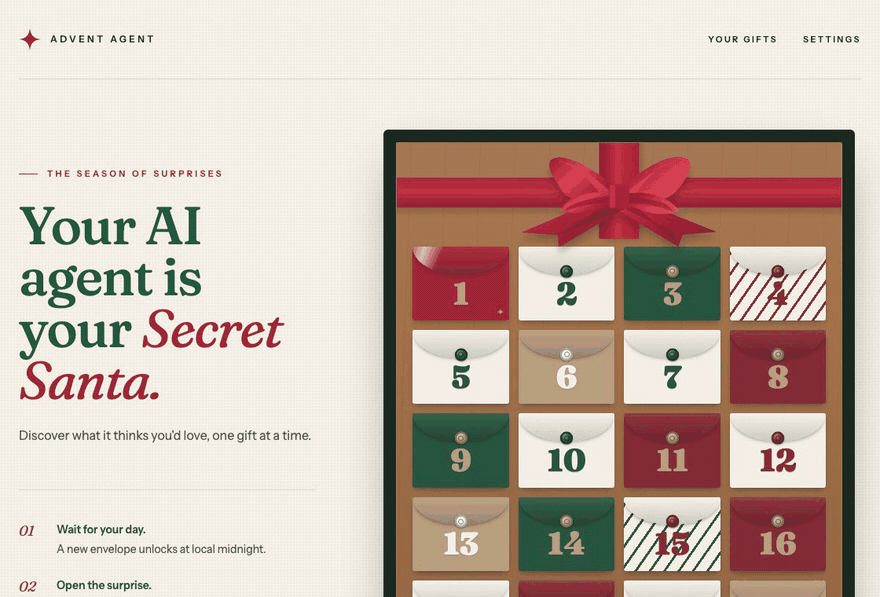

# Advent Agent

**The Advent Calendar Where Every Gift Is Chosen and Created by Your AI Agent**



Advent Agent is an advent calendar that lives on your computer. Twenty-four paper envelopes on a wooden board, and behind each one a small gift that your *own* AI agent (Claude Code, Codex…) made for you.

What is inside? We won't tell you, and neither will the calendar. That is the whole point.

Unwrap the Magic with one command:

```sh
npx advent-agent
```

Free, open source, and local: no account, no API keys, no tracking. Your agent never buys or books anything.

## Install

You need two things first.

**1. Node.js 22 or newer.** Check with `node -v`. If it is missing or older, get it from [nodejs.org](https://nodejs.org).

**2. A terminal AI agent, installed and logged in.** Any one of these:

| Agent | Get it |
|---|---|
| Claude Code | [claude.com/claude-code](https://claude.com/claude-code) |
| Codex CLI | [github.com/openai/codex](https://github.com/openai/codex) |
| Antigravity CLI | [antigravity.google](https://antigravity.google/) |

Open it once in a terminal and ask it anything, so you know it works and is logged in. More agents are listed [below](#works-with).

**3. Start the calendar.**

```sh
npx advent-agent
```

Your browser opens on the calendar. That's it: nothing to clone, nothing to configure by hand.

> Not sure everything is in place? `npx advent-agent doctor` lists what it found: Node, your agents, a browser for sharing.

## Use it

1. **Answer a few questions.** Which agent is your Secret Santa (or which of your own personas), when it should work (when you open a door, or the night before), and how generous it should be.
2. **Let it wrap Door 1.** Your Secret Santa checks its list to learn who it is giving to, then makes the first gift, so it opens instantly on December 1.
3. **Come back each day.** Run `npx advent-agent` again, click the day's envelope, and unwrap. Door N unlocks on December N.

Missed a few days? The doors wait for you; nothing expires. Started late? The doors that are already due are made for you.

## How it works

- **The calendar** is a small program on your computer with a page in your browser. It keeps the doors locked until their day and never shows what is inside before you open one. Locked doors shake; they do not spoil.
- **Your agent** does the making. The calendar starts it quietly in a folder of its own, hands it a brief, and waits. You only see spoiler-free steps: thinking, making, testing, wrapping.
- **Every gift is checked** before it is sealed, and opens in an isolated frame, so a gift cannot touch the calendar or your files.
- **The season has a shape.** Day 1 is ready at setup, December 24 is the big one.
- **Keep what you like.** *Save* gives you the gift in its own format. *Share* exports a picture or a short video, with a preview and a way to blur anything private. Nothing is uploaded.

## Requirements

- **Node.js 22 or newer** (tested on 22 and 24), on macOS, Linux or Windows.
- **A supported terminal agent**, installed and logged in.
- **Chrome, Edge or Chromium**, only for sharing a gift as a picture or a short video. Everything else works without it.
- **ffmpeg** (optional): lets Share produce MP4 and GIF. Without it you get WebM.

## Works with

The calendar starts your agent itself, in a workspace of its own. Every agent can also be scheduled to work the night before (the computer has to be on).

| Agent | Status | Notes |
|---|---|---|
| **Claude Code** | Tested: made and sealed a gift on 20 November 2026 | Spend limit enforced (`--max-budget-usd`) when you set one |
| **Codex CLI** | Tested: made and sealed a gift on 20 November 2026 | Runs in its workspace-write sandbox; no token-limit flag, so the budget is advisory |
| **Antigravity CLI** (`agy`) | Tested: made and sealed a gift on 20 November 2026 | Runs in its own sandbox: commands can write only inside the calendar's workspace and have no network. No spend-limit flag, so the budget is advisory. Its web search cannot be switched off by the calendar |
| **Gemini CLI** | Flags verified, gift not tested | Since 18 June 2026 Google no longer serves Gemini CLI for personal accounts (free, AI Pro, AI Ultra) and points them to Antigravity CLI: on 20 November 2026 ours answered "This client is no longer supported". It still exists for paid API keys and enterprise licences, which we could not test |
| **OpenCode**, **Cursor CLI**, **Copilot CLI**, **Goose**, **Amp** | Built from documented flags, not yet verified on every machine | Marked as such in setup. See [docs/AGENT_COMPAT.md](docs/AGENT_COMPAT.md) |
| **Custom command** | You are responsible for what it does | Any agent you can start from a command line |

Any local script can also hand a gift in with `advent-agent submit`.

## What it costs

Advent Agent is free. Your agent uses its normal plan or billing, and the calendar sends nothing anywhere else.

**You decide the cost.** Two things set it:

- **Your agent's model.** It is the one set in your agent's own settings, and it decides most of the cost. The calendar never changes it. A larger or newer model can cost several times more for the same gift.
- **Your choices in setup** (you can change them in Settings at any time): a gift size (**Light**, **Standard** or **Generous**) and a spend limit, either **No limit** (the default: you trust your agent) or an amount in dollars per gift. Claude Code stops at the limit; other agents are told the limit but cannot be stopped.

For information only, here is what we measured between 8 and 10 November 2026, on Claude Code with Claude Sonnet 5.5 and Opus 5.5, with API billing:

| Size | A whole season, roughly |
|---|---|
| Light | about **$14** |
| Standard | about **$20** |
| Generous | more: tens of dollars (not measured well enough to give a number) |

Models and prices change, and we do not re-measure: take these as an order of magnitude from that week, not a quote. On a subscription, expect each gift to use a noticeable slice of your usage limit. Per-gift numbers and token counts: [docs/COSTS.md](docs/COSTS.md).

## Privacy and safety

- **Everything runs on your computer.** No account, no telemetry, no network calls of its own. Your agent talks to its usual model provider, as it always does.
- **The agent never buys or books anything.** If it suggests something, you decide.
- **"Checking the list" reads little, and you can see it.** Before Door 1 (and again on December 8 and 15), your agent reads copies of a few of its own instruction and memory files, at most 64 KB, and writes a short list about you. It counts against your spend limit like a gift does. You can read, edit or delete that list in Settings. It never reads session transcripts, source code, `.env` files, keys or credentials.
- **Gifts are untrusted.** They run in a sandboxed frame on a separate origin, with no network by default.

<details>
<summary>The details</summary>

- **Everything runs on your computer.** The calendar binds to `127.0.0.1`, checks the Host and Origin of every request, makes no network calls of its own, and has no telemetry. Your agent works as it normally does, including with its own model provider.
- **Checking the list.** Before Door 1 (and again on December 8 and 15), one short run of your own agent reads **copies** of a few files the app chooses: your agent's global instruction file, its per-project memory, and the instruction files of your projects (at most 64 KB in all). It writes a list of short lines, which you can read, edit or delete in Settings. It **never reads** session transcripts, source code, `.env` files, keys or credentials, or the calendar's own folders, and it leaves out secrets, health, money and anything on your avoid list. The list stays on your computer and is not part of exports.
- **The agent never buys or books anything.** If it suggests something, you decide.
- **Gifts are untrusted.** They run in an isolated, sandboxed frame on a separate origin, with a strict policy and no network by default.
- **Scheduled mode needs the computer on** at the hour your agent works.

The details, with the files that implement each claim, are in [docs/THREAT_MODEL.md](docs/THREAT_MODEL.md). Report a vulnerability through the repository's private vulnerability reporting: see [SECURITY.md](SECURITY.md).

</details>

## FAQ

**What will the gifts be?** We don't know. Your agent decides what each gift is. The idea library gives it suggestions, but it does not have to follow them: the choice is always your agent's.

**Will I see what a gift is before I open it?** No. Not in the app, not in this README, not on the website. Locks prevent accidental spoilers. They are not a vault: changing your computer's clock opens doors.

**Does my agent buy things?** No. Advent Agent never makes purchases or bookings.

**Do I need API keys or paid services?** No. Optional advanced settings let you add your own image provider, stored in your OS keychain and used with a spend cap.

**How does my Secret Santa know me?** Through its list (see above). You can also choose one of your own personas (a Claude Code agent or output style, or a project instruction file that gives your agent a name and voice) as your Secret Santa; its notes are signed with its name.

**Do I need to come back every day?** No. Missed doors wait for you and pile up. Settings offers an optional calendar file (`.ics`) with a daily reminder.

**Does the calendar have to stay open?** No. Run `npx advent-agent` when you want to open a door. If you chose scheduled gifts, `advent-agent service install` starts it at login so your agent can work the night before.

**Can I share my gifts?** Yes. Share exports a picture or a short video, with a preview first and a way to blur anything private. Nothing is uploaded. Save downloads the gift itself in its own format.

**What if I want a gift again, or as a tool?** Your agent sometimes offers a second life in its note (a desktop version, a terminal command). Say yes and it builds it then; it never installs anything unasked.

**Is it free?** Yes: MIT-licensed code and a CC BY gift library.

## Troubleshooting

Start with `advent-agent doctor`: it prints versions, your agents, prerequisites and recent errors, with paths and names removed. Include its output in a bug report, and never paste your list, your agent's memory files or gift contents.

- **"Agent not installed" or not detected.** `doctor` shows what it found on your PATH. Install the agent, log in once in a terminal, then retry the door.
- **"Not authenticated", "rate limited" or "model unavailable".** These come from the agent itself. Log in again, wait for the limit to reset, or pick another model in the agent's own settings, then retry.
- **Sharing says no browser was found.** Install Chrome, Edge or Chromium. Settings can also fetch a small Playwright Chromium for the optional gift test drive.
- **Port in use.** The calendar uses 4224 (app) and 4225 (gifts). Stop the program using them and start again; `doctor` prints the ports the calendar expects.
- **A door failed.** Open it again to retry. If it keeps failing, the door's private log is in `~/.advent-agent/seasons/<year>/doors/NN/log.txt`; it can contain your agent's output, so look before sharing.
- **Doors opened too early or too late.** Locks follow your computer's clock and the timezone frozen at setup.

Known gaps are in [docs/KNOWN_LIMITATIONS.md](docs/KNOWN_LIMITATIONS.md).

## Useful commands

```
advent-agent                  start and open the calendar
advent-agent doctor           versions, agents, prerequisites, recent errors (redacted)
advent-agent status           door states, no spoilers
advent-agent service install  start the companion at login (scheduled mode)
advent-agent export | import  your seasons as a zip, without secrets
advent-agent version | help
```

## What's in this repo

- `src/`, `ui/`: the companion and the calendar page.
- `workshop/`: the Gift Workshop, the skills and building blocks agents use to make gifts.
- `gift-library/`: the idea library. **Spoilers** if you plan to use the calendar yourself.
- `schema/`: the gift package format (`gift@2`) as a JSON schema.
- [BUILDING_ADVENT_AGENT.md](BUILDING_ADVENT_AGENT.md): how and why it is built, the fifteen rules, and the lessons from the lab.

## Credits

Advent Agent is made by [@suchipizza](https://github.com/suchipizza) at [Desk Menace](https://deskmenace.com/?ref=aa-readme). Gary, Desk Menace's grumpy desktop character, walks across the calendar page. Right-click him and choose "Remove Gary" (he stays away until the next day), or switch him off for good in Settings. The project is free, and that is how Desk Menace says hello. Gary is never part of a gift.

## Contributing

Ideas, kit blocks, agent adapters and fixes are welcome. Start with [CONTRIBUTING.md](CONTRIBUTING.md), [GOVERNANCE.md](GOVERNANCE.md) and the [Code of Conduct](CODE_OF_CONDUCT.md). Development basics:

```
npm install
npm run build          # server + UI + schema
npm test               # unit + integration (fake agent, auth, scheduler, workspace, list)
npm run e2e            # Playwright against the internal fixture calendar
npm run test:packaging # npm pack → clean install → doctor + start
```

## Licences

- **Code:** MIT, see [LICENSE](LICENSE).
- **Gift library** (`gift-library/`): CC BY 4.0, see [gift-library/LICENSE](gift-library/LICENSE).
- **Names and artwork:** "Advent Agent", "Desk Menace", Gary and the logos are not covered by those licences: see [TRADEMARKS.md](TRADEMARKS.md). Third-party material is listed in [THIRD_PARTY.md](THIRD_PARTY.md).
